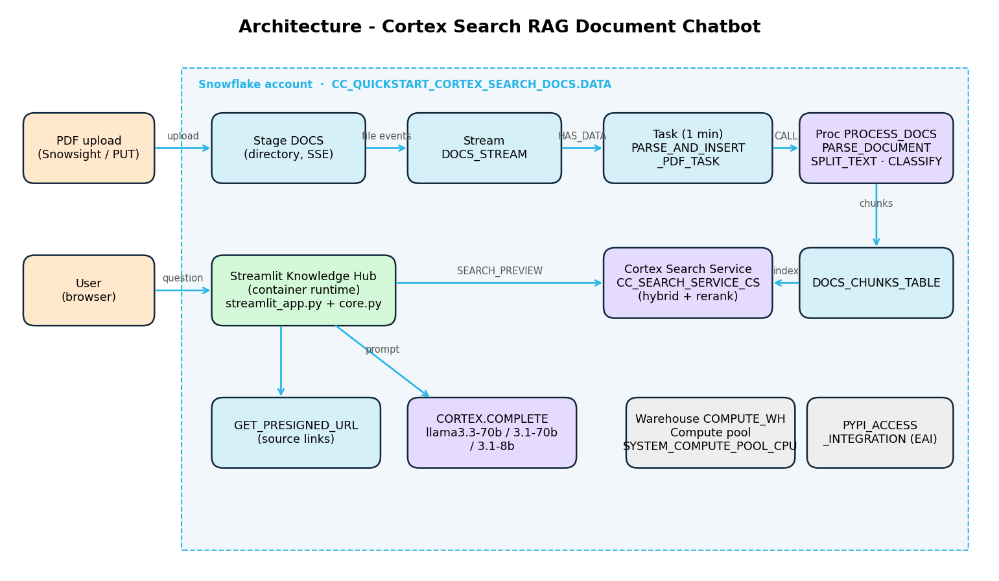

# 2. Architecture



## 2.1 Layers
| Layer | Components | Responsibility |
|---|---|---|
| **Ingestion** | Stage `DOCS`, stream `DOCS_STREAM`, task `PARSE_AND_INSERT_PDF_TASK` | Detect new and removed files |
| **Processing** | Procedure `PROCESS_DOCS` → `PARSE_DOCUMENT`, `SPLIT_TEXT_RECURSIVE_CHARACTER`, `CLASSIFY_TEXT` | Turn PDFs into classified text chunks |
| **Knowledge store** | `DOCS_CHUNKS_TABLE` | Single source of truth for searchable passages |
| **Retrieval** | Cortex Search Service `CC_SEARCH_SERVICE_CS` | Hybrid semantic + lexical search with reranking and a category filter |
| **Generation** | `SNOWFLAKE.CORTEX.COMPLETE` (Llama 3.x) | Query rewriting and grounded answer generation |
| **Presentation** | Streamlit "Knowledge Hub" with the "Chat Document Assistant with Snowflake Cortex" Ask tab (`streamlit_app.py` UI, `core.py` logic), container runtime | Chat, browsing, activity log, feedback |
| **Platform** | `COMPUTE_WH`, `SYSTEM_COMPUTE_POOL_CPU`, `PYPI_ACCESS_INTEGRATION` | Compute for SQL and the app; package installs |

## 2.2 Application module design
```
cortex-doc-chatbot/
├── streamlit_app.py   # UI: header, sidebar options, Ask ("Chat Document Assistant with Snowflake Cortex") / Browse documents / Activity tabs
├── core.py            # Logic: connection, caching, search, prompts, COMPLETE, URLs, timing
├── snowflake.yml      # Deploy: warehouse, compute pool, EAI, artifacts (pyproject, app, core, config)
├── pyproject.toml     # streamlit[snowflake]>=1.54.0
├── .streamlit/config.toml
└── cleanup.sql
```
The UI and the RAG logic are separate, so the UI was redesigned several times without changing `core.py`'s retrieval and generation logic.

## 2.3 Key functions in `core.py`
| Function | SQL / service | Notes |
|---|---|---|
| `load_documents()`, `load_categories()`, `stats()` | `DOCS_CHUNKS_TABLE` | `@st.cache_data(ttl=300)`; cleared by "Refresh documents" |
| `search_chunks(query, category, limit)` | `SEARCH_PREVIEW(service, json)` | `@eq` filter on category unless `ALL` |
| `summarize_question_with_history()` | `COMPLETE` | Rewrites a follow-up into a standalone query |
| `create_prompt()` | — | Instructions + JSON chat history + JSON context chunks + question |
| `answer()` | `COMPLETE`, `GET_PRESIGNED_URL` | Returns content, sources, search query, evidence, model, category, latency, timestamp |
| `submit()` | — | Appends the user message; rolls it back if the call fails |

## 2.4 Data model – `DOCS_CHUNKS_TABLE`
| Column | Type | Example |
|---|---|---|
| RELATIVE_PATH | VARCHAR | `Premium_Bicycle_User_Guide.pdf` |
| SIZE | NUMBER | 2331 |
| FILE_URL / SCOPED_FILE_URL | VARCHAR | stage URLs |
| CHUNK | VARCHAR | markdown text, ≤ 1512 chars |
| CHUNK_INDEX | INTEGER | 0 |
| CATEGORY | VARCHAR | `Bike` |

## 2.5 Security
- Snowflake RBAC; `st.connection("snowflake")` uses the app's embedded identity, so there are no credentials in code.
- All user inputs (question, model, category, path) are passed as **bound parameters**; HTML output is escaped (`html.escape`).
- Stage files are encrypted (`SNOWFLAKE_SSE`); documents are exposed only through 6-minute presigned URLs.
- The external access integration is limited to Snowflake's managed PyPI network rule.

## 2.6 Scalability and cost
- Chunking and classification are set-based SQL, so they run in parallel on the warehouse.
- Cortex Search is serverless and refreshes incrementally within `TARGET_LAG`.
- The task is conditional (`SYSTEM$STREAM_HAS_DATA`), so runs with no new files are skipped.
