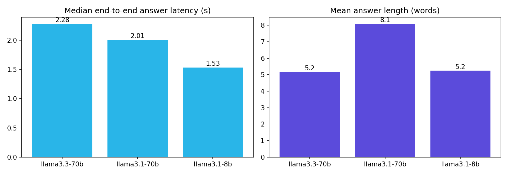

# 5. Evaluation Metrics

Raw results: [eval_results.json](eval_results.json) (run 2, 2026-10-15).

## 5.1 Method
- **Test set:** 12 factual questions with a known source document and expected answer keywords, covering all 5 documents
  (9 with category ALL, 3 filtered). Also tested: **2 out-of-scope** questions and **2 two-turn follow-up** dialogues.
- **Configuration:** passages = 3, history on, window = 7. Each model ran through `core.answer()`, the same code the UI uses.
- **Scoring (automatic):** an answer is correct if it contains an expected keyword. A retrieval is a hit if the expected document
  is in the top-k. An out-of-scope answer counts as an abstention if it says the information isn't available.
- **Latency:** wall-clock time from the client, including all SQL round trips (rewrite, search, COMPLETE, URL signing).
- The evaluation was run **twice** (runs 1 and 2) to show latency variance.

## 5.2 Retrieval (Cortex Search)
| Metric | Value |
|---|---|
| Hit@1 | **100 %** (12/12) |
| Hit@3 | **100 %** (12/12) |
| Mean Reciprocal Rank | **1.000** |
| Median search latency | **0.53 s** (range 0.41–0.96 s) |

## 5.3 Generation by model (run 2)
| Metric | llama3.3-70b (default) | llama3.1-70b | llama3.1-8b |
|---|---|---|---|
| Answer accuracy | **100 %** (12/12) | **100 %** (12/12) | **100 %** (12/12) |
| Source attribution (expected doc shown) | 100 % | 100 % | 100 % |
| Abstention on out-of-scope | 2/2 | 2/2 | 2/2 |
| Follow-up resolution with history | 2/2 | 2/2 | 2/2 |
| Median latency – single turn | 2.28 s | 2.01 s | **1.53 s** |
| Mean / p90 latency | 3.03 / 5.94 s | 2.06 / 2.62 s | **1.59 / 1.69 s** |
| Max latency | 6.98 s | 2.64 s | 2.01 s |
| Follow-up latency (rewrite + answer) | 7.7 / 9.3 s | 4.8 / 2.9 s | **2.2 / 2.2 s** |
| Mean answer length | 5.2 words | 8.1 words | 5.2 words |

## 5.4 Latency stability across runs (median single-turn)
| Model | Run 1 | Run 2 |
|---|---|---|
| llama3.3-70b | 1.66 s | 2.28 s (p90 5.94 s) |
| llama3.1-70b | 2.13 s | 2.01 s |
| llama3.1-8b | 1.52 s | 1.53 s |

## 5.5 UI run (from the screenshots)
| Interaction | Latency shown in the app |
|---|---|
| First question (ALL) | 2.7 s |
| Follow-up with history | 3.6 s |
| Out-of-scope question | 1.9 s |
| Category-filtered question (Snow) | 1.8 s |

## 5.6 Pipeline
| Metric | Value |
|---|---|
| Documents processed | 5 / 5 |
| Classification accuracy (Bike/Snow) | 5 / 5 |
| Task run time for a new upload | 10 s (schedule ≤ 1 min) |
| Chunks → searchable | ≤ 1 min (`TARGET_LAG`) |
| Runs with no new files | Skipped (no compute) |
| Working LLMs in the region | 3 of 11 tested |

## 5.7 Caveats
- The corpus is **very small** (5 short documents, 1 chunk each), so retrieval is easy. Treat the 100 % scores as an upper bound.
- Keyword scoring checks that the fact is present, not whether the whole answer is complete or free of extra claims.
  For production, add LLM-as-judge or human scoring (faithfulness, answer relevance, context precision) on a larger set.
- Context precision is low by design: with passages = 3 and only 3 Bike docs, 2 of the 3 retrieved passages are often unrelated
  (visible as extra source links in the UI).
